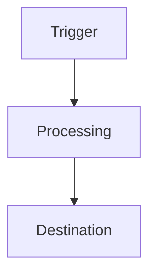

Related: [REQUIREMENTS.md](./REQUIREMENTS.md) | [CURRENT_STATE_REFERENCES.md](./CURRENT_STATE_REFERENCES.md) | [IMPLEMENTATION_PLAN.md](./IMPLEMENTATION_PLAN.md)

## Design status

<Draft | Design Approved>

## Problem being solved

<One or two sentences, cross-referencing the requirement IDs from REQUIREMENTS.md this design satisfies, e.g. FR-001, NFR-001.>

## Proposed architecture

<Narrative description of the solution and how the involved platforms fit together.>

## Systems involved

- <system — role in this design>

## Trigger

<Exact trigger: webhook, schedule, Monday automation, manual, etc. Include scheduling detail if relevant.>

## Inputs

| Input | Source | Required? | Notes |
|---|---|---|---|
| <field/payload> | <system> | <Yes \| No> | |

## Outputs

| Output | Destination | Notes |
|---|---|---|
| <field/record> | <system> | |

## Proposed data flow

## Module/action sequence

| Step | Platform | Module or action | Purpose | Inputs | Outputs | Failure behaviour |
|---|---|---|---|---|---|---|
| 1 | <Make.com \| Power Automate \| Monday \| Google Cloud> | <exact module/action name> | | | | |

## Filters and routing

<Router branches, filter conditions, or Not applicable.>

## Mappings

<Field-to-field mapping table or reference to `make/mappings/` file.>

## IDs and identifiers

<Exact board IDs, column IDs, scenario IDs, connection names to be used. TODO: verify anything not yet confirmed.>

## Duplicate prevention

<Mechanism, e.g. dedupe key, data store lookup, Monday search-before-create.>

## Idempotency

<How reprocessing the same event is made safe.>

## Error handling

<Per-module error handler behaviour, retry policy, and where failures route to.>

## Logging

<What is logged and where, per CLAUDE.md section 17.>

## Alerts

<Who is notified, on what condition, and via which channel.>

## Manual recovery

<Steps an authorised person follows to recover after a failure.>

## Security

<Authentication, connection scope, data exposure considerations.>

## Permissions

<Who can view/edit the resulting board, scenario, flow or folder.>

## Rate limits

<Known API rate limits affecting this design, or Not applicable.>

## Performance considerations

<Expected volume, batching, concurrency limits, or Not applicable.>

## Dependencies

- <upstream/downstream automation, board, or system this design depends on>

## Alternatives considered

| Alternative | Why not chosen |
|---|---|
| <e.g. Monday native automation> | |

## Rejected alternatives

<Expand only if a rejected alternative needs a fuller explanation than the table above; otherwise Not applicable.>

## Risks

| Risk | Likelihood | Impact | Mitigation |
|---|---|---|---|
| | | | |

## Open design questions

- <question blocking design approval, or Not applicable>

## Design approval

| Approver | Date | Decision |
|---|---|---|
| <name> | <YYYY-MM-DD> | <Pending \| Approved \| Rejected> |
